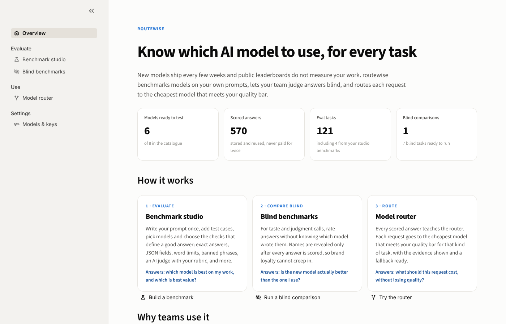
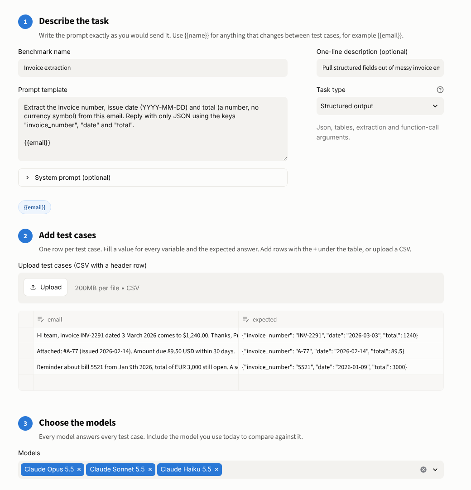
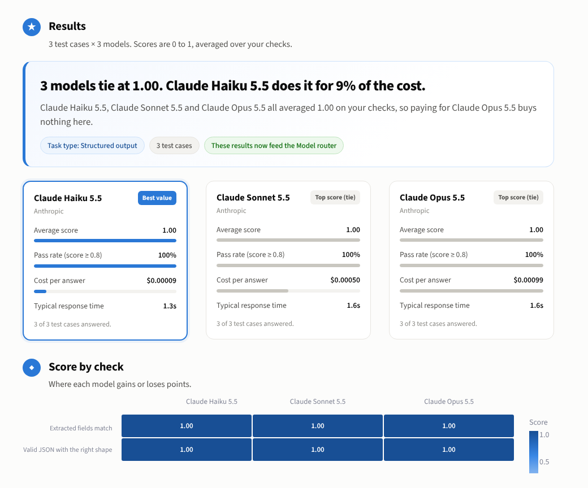
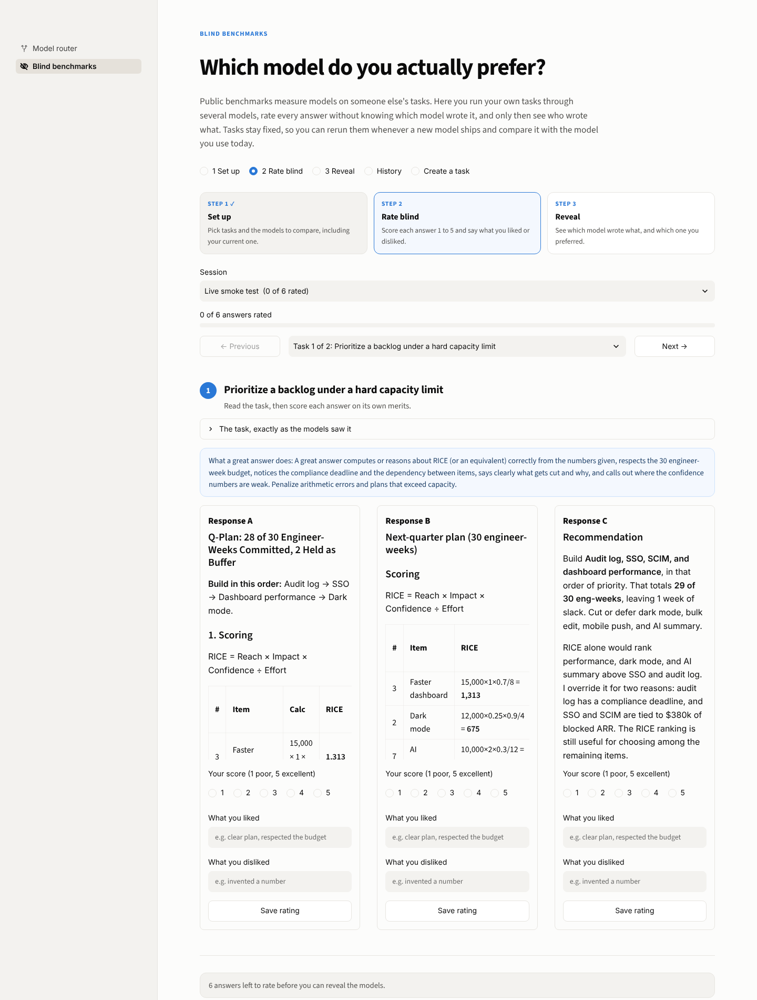
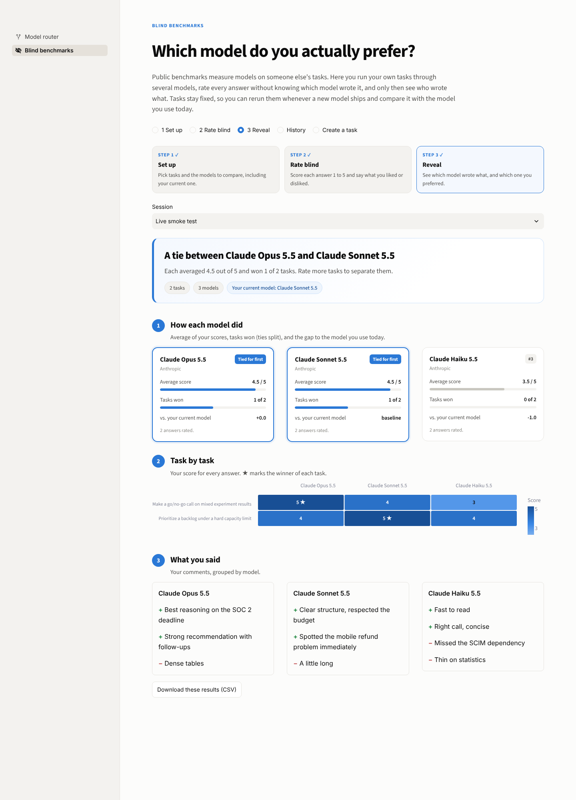

# routewise

**Know which AI model to use, for every task.** New models ship every few weeks, and public
leaderboards do not measure your work. routewise benchmarks models on your own prompts, lets
your team judge answers blind, and routes each request to the cheapest model that meets your
quality bar, with the evidence for every decision.



## The product in one loop

1. **Evaluate: Benchmark studio.** Write a prompt once, add test cases, pick any models, and
   choose the checks that define a good answer. Get a verdict on quality and on value, every
   answer side by side, and a shareable report. No code, no YAML.
2. **Compare blind: Blind benchmarks.** For taste and judgment calls, rate answers without
   knowing which model wrote them, then reveal which model you actually prefer versus the one
   you use today.
3. **Route: Model router.** Every scored answer teaches the router, which sends each request to
   the model with the best quality, cost and latency trade-off for that kind of task, behind an
   OpenAI-compatible endpoint with failover.

Around the loop: bring-your-own API keys (or your Claude plan), a cost estimate and hard budget
cap on every run, cached answers so reruns only pay for what is new, a CI gate that fails on
quality regressions, and 110 built-in eval tasks.

## What

- **Benchmark studio.** Eleven ready-made checks (exact answer, number match, JSON fields, JSON
  schema, required and banned phrases, word limits, keeps-the-numbers, regex, no personal data,
  and an AI judge with your rubric), each with a weight and an optional must-pass flag. Four
  starter templates. Test cases by table or CSV upload. Results feed the router.
- **Router.** `route(query, mode)` classifies the query (structured output, reasoning,
  summarization, voice, safety), looks up per-category eval results, and picks a model in
  `quality`, `balanced` or `cost` mode. It returns a plain-English rationale naming the
  category, the top two contenders, and why the winner won. A guard never picks a model whose
  measured quality is more than a set margin below the best.
- **Evals.** 110 tasks: 16 hand-written core tasks with gold answers and anchored judge rubrics,
  52 templated tasks in YAML packs, and 42 script-generated hard tasks whose gold answers are
  computed (code is executed, puzzles are brute-force verified).
- **Proof.** A leave-one-out replay of the eval set compares the router against always using
  the flagship, every fixed model, and an oracle. Bootstrap confidence intervals on every
  leaderboard mean.
- **Blind benchmarks.** Your own judgement as the benchmark: run fixed, real-work tasks across
  models, rate each response without knowing which model wrote it, then reveal which model you
  preferred and how it compares with the model you use today. Ships with seven product
  management benchmarks; add your own.
- **Operations.** OpenAI-compatible `/v1/chat/completions` with failover, a CI gate that fails
  on quality regressions or missing results, a budget cap, an opt-in response cache in the chat
  client, and an audit that finds broken gold answers.

## Quick start

```bash
uv sync
uv run routewise import            # load the shipped seed results (no API calls)
uv run routewise dashboard         # http://localhost:8501
```

The dashboard opens on the Overview. Then:

- **Models & keys**: see which models are ready. Claude models work through the `claude` CLI on
  your Claude plan with no key; for other providers paste your own API key (until the app restarts, or
  saved to the git-ignored `.env`).
- **Benchmark studio**: load the *Word problems* template, pick two models, press **Run**.
- **Model router**: type a prompt and see which model it would use and why.

From the command line:

```bash
uv run routewise route "Extract the order id and total as JSON" --mode balanced
uv run routewise report            # markdown tables
uv run routewise eval --limit 4    # cheap smoke run: first 4 tasks x every enabled model
uv run routewise eval              # everything; reruns skip results already recorded
```

## Benchmark studio

Benchmark any model on your own work in five steps, all on one page:

1. **Describe the task.** The prompt exactly as you would send it, with `{{placeholders}}` for
   whatever changes between test cases. An optional system prompt. The task type is suggested
   for you.
2. **Add test cases.** One row per case: a value for each placeholder, plus the expected answer
   when a check needs one. Edit in the table or upload a CSV.
3. **Choose the models.** Every ready model is listed; include the one you use today.
4. **Choose how answers are scored.** Pick checks, tune them, weight them, mark any as must-pass
   (a failed must-pass check scores the whole answer 0).
5. **Review and run.** Plain-language problems block the run until fixed. You see the number of
   new model calls, the estimated cost (answers already stored are free), and set a hard spend
   cap.



Results lead with a verdict that is honest about ties, then a card per model (score, pass rate,
cost per answer, latency), a score-by-check heatmap, and every answer with the reason each
check passed or failed. Download a self-contained HTML report, the answers as CSV, or the
benchmark as YAML.



Saved benchmarks (in `data/studio/`, git-ignored) rerun with one click when a new model ships,
and join the router's evidence automatically. Editing checks rescores stored answers without
new model calls; editing the prompt starts a fresh version.

Run them headless too, for example as a CI gate on the model you ship:

```bash
uv run routewise studio list
uv run routewise studio run word-problems --models claude-haiku-5-5,claude-sonnet-5-5 \
    --max-cost 1 --min-score 0.9 --html report.html     # exit 1 if any model is below 0.9
```

Live run on the four starter templates (Claude plan, October 2026): Haiku 5.5, Sonnet 5.5 and
Opus 5.5 all score 1.00 on Invoice extraction and Faithful summaries, Haiku and Sonnet both score
1.00 on Word problems, and on Support replies (AI judge) Haiku ties Opus at 0.92 with Sonnet at
0.88. Haiku costs 5 to 9 percent as much per answer as Opus on these. That is the point of the
product: on a lot of real work, the flagship buys nothing, and now you can prove it.

## Blind benchmarks

Public benchmarks tell you how models do on someone else's tasks. Blind benchmarks tell you
which model *you* prefer on *your* tasks, without brand bias.





*The reveal above uses example ratings for illustration.*

1. **Start a session** (dashboard page "Blind benchmarks", or `routewise bench run`): pick
   benchmarks, two or more models, and your current model as the baseline. Every model answers
   every benchmark.
2. **Rate blind.** Each benchmark shows its responses as Response A, B, C in an order shuffled
   per benchmark. Model and vendor names are masked, models are told not to identify
   themselves, and cost and latency are hidden. Give each response a 1 to 5 score and a
   sentence on what you liked or disliked.
3. **Reveal.** Only once every response is rated: your preferred model, mean scores, prompt
   wins, each model against your baseline, and your comments grouped by model.
4. **Repeat when a new model ships.** Benchmark prompts are versioned, and the history view
   only compares ratings made on identical prompts, so results stay comparable over time.

Built-in product management benchmarks (`data/benchmarks/pm-core.yaml`): turning a messy
request into a PRD, prioritizing a backlog under a capacity limit, synthesizing user
interviews, defining metrics and an A/B test, an executive update with bad news, a go/no-go
call on mixed experiment results, and responding to a competitor's price cut. Each comes with
rater guidance on what a great answer does (shown to you, never to the models).

Create your own in the "Create a benchmark" tab. They are saved to `data/benchmarks/custom/`,
which is gitignored so private work prompts are never pushed by accident.

```bash
uv run routewise bench list
uv run routewise bench run --models claude-sonnet-5-5,gpt-6.1-sol,claude-haiku-5-5 \
    --baseline claude-sonnet-5-5 --suite pm-core
uv run routewise dashboard        # rate on the "Blind benchmarks" page, then reveal
uv run routewise bench history
```

Blinding is not perfect: writing style and length can hint at a model. Rate on substance.

## Architecture

```
                         +----------------------------- eval loop -----------------------------+
                         |                                                                      |
  tasks (core + YAML     v                                                                      |
  packs + generated) --> runner --> chat() --> model --> scorers + LLM judge --> SQLite results -+
                                    (LiteLLM | claude CLI | mock)                     |
                                                                                      v
  query --> classifier ----------> leaderboard (per model x category: --> router --> model
            (neighbours over        mean quality, CI, cost, latency)     (mode weights,   (failover
             eval prompts,                                                quality guard)    to next)
             keyword rules,                                                   |
             optional LLM)                                                    +--> rationale
```

| Module | Role |
| --- | --- |
| `routewise/models/` | Model registry and prices (`config/models.yaml`), async `chat()` with retries, cache and three backends |
| `routewise/evals/` | Task format and scorers, built-in tasks, YAML pack loader, runner, result store, rescore, audit |
| `routewise/router/` | Classifier, leaderboard, routing policy (`config/router.yaml`), replay, report, gate |
| `routewise/dashboard/` | Streamlit app |
| `routewise/server.py` | OpenAI-compatible endpoint |
| `routewise/cli.py` | `routewise` command |

## Methodology

**Routing score.** For each candidate model in the query's category:

```
score = w_quality * quality - w_cost * cost / max_cost - w_latency * latency / max_latency
```

Weights per mode live in `config/router.yaml`. In `quality` mode cost and latency only break
near-ties. `balanced` and `cost` modes also refuse any model more than `max_quality_drop` below
the category's best (0.10 and 0.15). Categories with fewer than `min_samples` results per model
fall back to overall scores. Queries nothing recognizes are routed on overall scores too.

**Classifier.** The router classifies the whole request (system prompt plus user turn):

1. Nearest neighbours (TF-IDF cosine) over the labelled eval prompts, so every task you add
   also teaches the classifier.
2. Keyword rules, with matches in the first 200 characters (the instruction) counting double, so
   a pasted document full of the word "bug" does not turn a summary request into debugging.
3. Optionally, a cheap LLM for anything left over (`classifier.llm_fallback`).

**Scorers.** Every task lists its scorers as data, so the runner needs no per-task code.
Programmatic: `exact_match` (text, number, regex group, JSON fields), `schema_valid`,
`slot_f1` (dict slots or lists of items, with "contains" and "any of" gold values),
`number_preservation`, `word_count_cap`, `bullet_count`, `pii_absent`, `forbidden_strings`,
`contains_all`, `contains_any`, `regex_match`. Every score is a float in [0, 1] with a reason.
A component can be `required`: if it scores 0 the task scores 0, so a wrong answer cannot
earn half credit for nice prose.

**LLM judge.** For qualities code cannot check (tone, faithfulness, explanation quality), a
cheap judge model grades against an anchored 1-5 rubric stored on the task itself (so grading
is auditable in the diff), returns JSON, and is normalized to (score - 1) / 4. The response is
fenced and the judge is told to treat it as data, not instructions. An unparseable verdict is
recorded as an error and retried, never silently scored 0.

**Versioning.** A task's version hashes only what the model sees (prompt and system prompt).
Editing a prompt invalidates old results; fixing a gold answer or scorer does not, and
`routewise rescore` reapplies scorers to stored outputs at no model cost.

**Replay.** For each eval task the router decides with a leaderboard and neighbour index that
exclude that task (leave-one-out), then takes the recorded result of the model it chose.

**Audit.** `routewise audit` flags tasks where every model scores the same imperfect value
(independent models rarely make the identical mistake, so suspect the gold), tasks every model
aces (saturated), tasks where models disagree (the ones that drive routing), and tasks where
one model's repeated samples disagree (flaky). Its first run caught three gold-answer bugs in
this repo's own task packs.

## Results

Seeded on 2026-10-14 against Claude Opus 5.5, Sonnet 5.5 and Haiku 5.5: 110 tasks, 504 results
(the core and hard suites were sampled twice). Full tables in [results/report.md](results/report.md).

| Model | Mean quality (95% CI) | Mean cost / task | Total cost | n |
|---|---|---|---|---|
| claude-opus-5-5 | 1.00 (1.00-1.00) | $0.00613 | $1.0290 | 168 |
| claude-sonnet-5-5 | 1.00 (0.99-1.00) | $0.00367 | $0.6161 | 168 |
| claude-haiku-5-5 | 0.99 (0.99-1.00) | $0.00035 | $0.0584 | 168 |

| Model | reasoning | safety | structured_output | summarization | voice | overall |
|---|---|---|---|---|---|---|
| claude-haiku-5-5 | 1.00 | 1.00 | 1.00 | 0.95 | 0.98 | 0.99 |
| claude-opus-5-5 | 1.00 | 1.00 | 1.00 | 0.99 | 1.00 | 1.00 |
| claude-sonnet-5-5 | 1.00 | 1.00 | 1.00 | 1.00 | 0.97 | 1.00 |

Router replay (leave-one-out) against always using the flagship (Opus):

| Mode | Router quality | Flagship quality | Router cost | Flagship cost | Savings |
|---|---|---|---|---|---|
| quality | 0.997 | 0.999 | $0.0688 | $0.5605 | 88% |
| balanced | 0.995 | 0.999 | $0.0331 | $0.5605 | 94% |
| cost | 0.995 | 0.999 | $0.0331 | $0.5605 | 94% |

Classifier accuracy on the 110 tasks (leave-one-out): 97%.

**Interpretation.** On this task set the three Claude 5.5 models are nearly indistinguishable:
104 of 110 tasks are saturated (every model perfect), including all 42 generated hard tasks
(code tracing, calendar arithmetic, five- and seven-person logic puzzles, 4-digit
multiplication chains, constrained writing). So the router saves money by sending almost
everything to Haiku, about 94% cheaper than always using Opus for a quality loss of 0.003,
which is inside the noise. The flagship still wins where judgement and tight constraints meet:
summarization (Haiku 0.95 vs Opus 0.99 and Sonnet 1.00, mostly one Haiku TL;DR that ran 61
words against a 60-word cap) and voice (Opus 1.00 vs Haiku 0.98 and Sonnet 0.97, mostly the
judged tone of the angry-customer reply and the barge-in response). But the audit shows every one of those six discriminative tasks
is also flaky across samples, so these gaps are not yet statistically meaningful. The honest
conclusion: for tasks like these, the router's job is less "pick the smart model" and more
"prove the cheap model is safe", and the eval set needs harder, more varied tasks before it can
justify paying for Opus on any category.

### How the seed results were produced

No API keys were used. Claude models ran through the local `claude -p` CLI on a Claude plan
(the `claude_code` backend, tools disabled, an empty working directory, a minimal system
prompt). Consequences:

- **Costs are list-price equivalents**, computed from `config/models.yaml`, not money spent.
- **Input tokens are estimated** (about 4 characters per token) because the CLI adds its own
  scaffolding tokens. Output tokens come from the CLI and include extended-thinking tokens.
- **Latency is the API time** the CLI reports, including thinking time, so it is higher and
  flatter across models than direct API calls would be. Do not read the latency columns as
  API benchmarks.
- Rows carry `backend` and `tokens_estimated` so API results can be told apart later.

## Models and keys

`config/models.yaml` lists each model with prices per 1M tokens. With `backend: auto`, a model
uses its provider API key through LiteLLM when one is set (`ANTHROPIC_API_KEY`,
`OPENAI_API_KEY`, `GEMINI_API_KEY`, see `.env.example`), and otherwise falls back to the
`claude` CLI for Claude models. `ROUTEWISE_BACKEND` forces one backend for everything.
The dashboard's **Models & keys** page shows each model's status and lets users paste their own
key until the app restarts or save it to `.env` (owner-only permissions, git-ignored, only ever shown
as its last four characters). Keys are never stored anywhere else.

Claude prices are verified against the list-price cost basis the CLI reports. The OpenAI
model ids (GPT-6 Astra, GPT-6.1 Sol, GPT-6 Luna) are verified against the OpenAI API; their
prices come from third-party trackers and are marked `price_verified: false`, so check them
against OpenAI's pricing page. Gemini entries are unverified and disabled. Enabled models you
have no key for are skipped by `routewise eval`, so you only pay for providers you configured.
`routewise models` shows each model's backend and price status.

## Scaling the evals

- **Task packs.** Drop a YAML file in `data/tasks/`. A pack holds static `tasks` and
  `templates` that expand over inline `cases` or a JSONL `cases_file`, with `{{placeholder}}`
  substitution (a value that is exactly `{{name}}` keeps its type).
- **Generators.** `scripts/generate_hard_pack.py` shows how to produce tasks whose gold answers
  are computed rather than hand-written; tests re-verify them.
- **Runs.** `--suite`, `--category`, `--tag`, `--task`, `--limit`, `--models`, `--repeats N`
  for variance, `--concurrency`, `--max-cost` budget cap (it stops starting new calls, so it
  can overshoot by up to one call per concurrent slot), `--dry-run`. Runs through the claude
  CLI stop cleanly when a plan limit is hit (exit code 3, same as a budget stop); errored rows
  retry on the next run, and an error never overwrites a good result. `--no-judge` skips tasks
  that need the judge rather than storing a partial score.
- **Quality control.** `routewise audit` after every run; `routewise rescore` after fixing
  gold; `routewise export` / `import` to share results without the database.

## Serving

```bash
uv run routewise serve --port 8000
```

```python
from openai import OpenAI

client = OpenAI(base_url="http://localhost:8000/v1", api_key="unused")
reply = client.chat.completions.create(
    model="routewise/balanced",  # or routewise/quality, routewise/cost, or a concrete model id
    messages=[{"role": "user", "content": "Summarize this thread: ..."}],
)
```

Responses carry a `routewise` object (mode, category, rationale, failover attempts, cost) and
`x-routewise-model` / `x-routewise-category` headers. If the chosen model errors, the request
fails over down the ranking. Streaming is not supported yet.

## CI and the eval gate

`.github/workflows/ci.yml` runs lint, format and the offline test suite (no API calls) on every
push and pull request. A manual `workflow_dispatch` job runs the core evals against real APIs
with a budget cap and fails if any (model, category) quality fell more than 0.05 below
`results/baseline-core.json`. The gate also fails when a baseline cell has no current results
(use `--allow-missing` to tolerate that), so a run cut short by the budget cap cannot pass
silently:

```bash
uv run routewise snapshot --suite core --out results/baseline-core.json   # accept a new baseline
uv run routewise gate --suite core --baseline results/baseline-core.json  # check against it
```

## Adding a model

1. Add an entry to `config/models.yaml`: `id`, `provider`, `litellm_model`, prices per 1M
   input and output tokens, and `cli_model` if it can run through the claude CLI.
2. Set the provider key in `.env`.
3. `uv run routewise eval --models <id> --limit 4`, then the full run. Existing results for
   other models are reused.
4. `uv run routewise report` and `routewise audit`. The router picks the new model up
   automatically once it has at least `min_samples` results per category.

## Adding an eval

1. Pick a category: `structured_output`, `reasoning`, `summarization`, `voice`, `safety`.
2. Add a task to a pack in `data/tasks/` (or a new pack). Give it a prompt, scorers, and a
   `reference_output` (a known-good answer). The test suite checks every reference scores 1.0,
   which catches broken gold data before any money is spent.
3. Prefer programmatic scorers. Use `llm_judge` with an anchored rubric (anchors for 5, 3 and
   1 at least) only for qualities code cannot check.
4. `uv run pytest`, then `uv run routewise eval --task <id>`.

## Development

```bash
uv sync
uv run pytest          # offline; mocks every model call
uv run ruff check . && uv run ruff format --check .
```

## Limitations

- **Small, mostly saturated eval set.** 110 tasks, most of them easy for current Claude models.
  Results are directional; per-category means rest on 10 (safety) to 92 (reasoning) results
  per model.
- **Judge noise and bias.** A single judge (Haiku 5.5 by default) grades its own family,
  including itself. Swap `--judge-model`, or average several judges, before trusting
  judge-heavy categories.
- **Seeded via the CLI**, so latency and input-token figures are approximations (see above).
- **Templated siblings** share wording, which flatters leave-one-out classifier accuracy.
- **Category-level routing.** The router uses per-category means, not per-query difficulty.
- **Only Claude models seeded.** OpenAI and Gemini entries are ready but unverified and
  disabled until keys are added.
